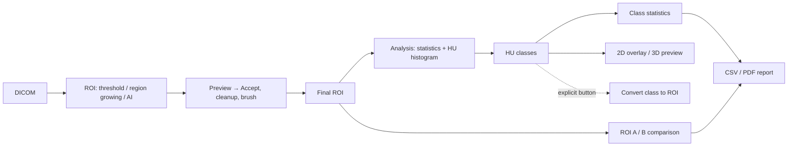

# CT3D / ROI Viewer — ROI quantitative analysis and reporting (04/11/2026)

Branch `enhancement/advanced-segmentation` (not Phase 15, not E7; no new AI model). Stable `thesis-ct-roi-tools` / tag `ct3d-rc1` (`aa1b3ad3`) unchanged. **Research software, not clinically validated; HU classes are not a diagnosis.**

## 1. Workflow

The analysis reads the current ROI and the CT volume only. Everything it shows is transient; the one path back into the project is the explicit "Chuyển lớp đang chọn thành ROI" button.

## 2. Components

| Part | File | Role |
|---|---|---|
| Statistics | `plugins/roi_viewer/core/analysis/roi_statistics.py` | voxel count, volume, HU min/max/mean/median/std, centroid (voxel, world), bounding box, 6-connected components, axial coverage, ROI-only histogram |
| HU classes | `core/analysis/hu_classes.py` | `HUClass` (class_id, display_name, min_hu, max_hu, display_color, visible, opacity), validation, classification, class statistics, overlay colour table, presets |
| Session / comparison | `core/analysis/analysis_session.py` | `ROIAnalysisSession` with source fingerprint and staleness, `analyse()`, `compare()` |
| Report | `core/analysis/analysis_report.py` | `ReportData`, deterministic CSV, filename sanitising, PDF (matplotlib PDF backend), centroid slice pictures |
| 3D preview | `core/analysis/analysis_preview_3d.py` | `AnalysisPreview3DManager`: one non-pickable actor per visible class |
| UI | `plugins/roi_viewer/gui/analysis_panel.py` | section "Phân tích ROI" on tab Công cụ (sub-sections "Phân lớp theo HU", "So sánh ROI"), workers, lifecycle |

`core/analysis/` imports no wx, pubsub or InVesalius module.

## 3. Definitions

- **Source**: the current ROI (`Slice().current_mask`), read with `core/native_mask.logical_foreground()` (completes InVesalius's lazy threshold, then `value > 127`). `Project().mask_dict` stays the source of truth; the session keeps the Mask object and its index.
- **Volume** = foreground voxels × sx × sy × sz (float64), the same quantity as Đo thể tích. A mesh volume, where shown, is a different quantity and is labelled as such.
- **HU statistics**: population standard deviation (ddof = 0). HU fields are disabled when the project modality is not CT.
- **Histogram**: voxels inside the ROI only; default range [floor(min), floor(max)+1), 100 bins; user range overridable; counts + below + above = ROI voxels.
- **Classes**: a voxel is in class c when it is in the ROI and c.min_hu ≤ HU < c.max_hu (half-open). Overlapping ranges are rejected; gaps are allowed and counted as **Chưa phân lớp**. Invariant: Σ class voxels + unclassified = ROI voxels. Visibility and opacity never change the computation. Up to 254 classes (uint8 labels).
- **Presets**: *Tùy chỉnh* (empty) and *Mật độ phổi (thử nghiệm)* — Emphysema [−1050, −950), Inflated [−950, −750), Infiltrated [−750, −400), Collapsed [−400, 0), Vessels / dense [0, 3071) — bands similar to the reviewed 3D Slicer Lung CT workflow, labelled "Tham khảo / thử nghiệm — không dùng để chẩn đoán", every range editable. No disease score is computed.
- **Comparison** (revised 04/11/2026, `docs/CT3D_ROI_ANALYSIS_FINAL_VALIDATION.md`): ROI A and ROI B are any two masks (nothing knows anatomy). Reported as A, B, **A + B** (arithmetic - shared voxels counted twice; labelled "có thể đếm trùng") and **A ∪ B** (each voxel once), plus intersection, only A, only B, **Dice** = 2|A∩B|/(|A|+|B|) and **IoU** = |A∩B|/|A∪B| (both empty → 1, one empty → 0). The first version called A + B "Tổng".
- **Staleness**: fingerprint = (shape, spacing, foreground count, blake2b of the packed foreground bits). A native edit (`Mask.modified()` callback) or a different fingerprint before any action marks the session stale: "ROI đã thay đổi. Hãy tính lại phân tích.", previews off, export/convert disabled. A deleted source is stale too. Project close/load and plugin close drop the session.
- **Isolation**: the 2D overlay uses its own `Slice().aux_matrices` key and never takes the slot from the segmentation preview (E2); the 3D actors are separate, non-pickable, never in `Project().surface_dict`, no camera change (except the one-time placement InVesalius would do when it has never placed a camera). No mask, E2 preview, E4/E5 actor, AI candidate or surface is changed by analysis.
- **Convert class to ROI**: the class's voxels → `native_mask.commit_preview_array_to_new_mask()` (the same commit as Region Growing and AI Accept), name "<parent> - <class>", no surface. **Undo**: it creates a new mask, not an edit of the parent - the parent's undo history is unchanged; the new ROI is removed with Xóa in the ROI list. A locked parent does not block it (nothing of the parent is written).
- **Report**: built only from the session, the comparison and recorded provenance. AI information appears only for a ROI accepted from AI **in the current session** (the accept path now records it, keyed by the Mask object); nothing is reconstructed for older ROIs. Pictures: axial/coronal/sagittal slices through the ROI centroid drawn from the arrays with true mm aspect - no screen capture, so the user's views and camera are untouched; the 3D view is not included. Default filenames: `<roi>_analysis_<YYYYMMDD>` (ASCII), never the project/series name. Local files only.
- **Threads**: compute, comparison, 3D meshes and PDF writing run on workers; results return with `wx.CallAfter` and a generation guard (a late result after a reset is dropped). The per-action staleness check stays on the UI thread (≈ 0.1 s on 0543).

## 4. Technical validation on 0543 (not ground truth)

Data: `D:\PyTools\dicom_samples\0543_slc_01_300`, loaded with InVesalius's own reader (300 × 512 × 512, 0.5859 × 0.5859 × 1.0 mm, CT). ROI: TotalSegmentator through the plugin's provider (full task, 121.6 s on CUDA for the first lobe, 1.0–1.7 s for the others), left lung = upper + lower left lobes, right lung = the three right lobes. Free RAM was ~2 GB during the run.

Left lung (`AI - lung_left`):

| Quantity | Value |
|---|---|
| Voxels | 3,408,753 |
| Volume | 1,170.30 ml (1,170,302.47 mm³) — Đo thể tích gives the same value (difference < 1e-6 mm³) |
| Mesh volume (separate quantity, E4 mesh) | 1,170.3 ml |
| HU min / max / mean / median / std | −1000 / 777 / −734.39 / −792 / 174.37 |
| Components | 2 (largest 3,407,414 voxels) |
| Axial slices | 37–269 (233 slices) |
| Histogram | [−1000, 778), 100 bins of 17.78 HU, peak [−822, −804); counts + outside = ROI voxels |
| Time | analysis 2.1 s, histogram 0.1 s, classification 0.74 s, comparison 6.7–7.7 s (worker) |

Lung density preset (experimental):

| Class | HU range | Voxels | ml | % ROI |
|---|---|---:|---:|---:|
| Emphysema | [−1050, −950) | 4,187 | 1.44 | 0.12 |
| Inflated | [−950, −750) | 2,229,749 | 765.52 | 65.41 |
| Infiltrated | [−750, −400) | 961,500 | 330.10 | 28.21 |
| Collapsed | [−400, 0) | 183,376 | 62.96 | 5.38 |
| Vessels / dense | [0, 3071) | 29,941 | 10.28 | 0.88 |
| Chưa phân lớp | – | 0 | 0 | 0 |

**Class accounting: exact** (3,408,753 = sum of the classes). This scanner stores nothing below −1000 HU (RescaleIntercept −1000), so the Emphysema band is effectively [−1000, −950). These percentages describe this preset on this scan; they are not a finding.

Comparison A = left lung, B = right lung: volume 1,170.30 / 2,121.15 / total 3,291.46 ml; HU mean −734.4 / −762.5 / −752.5; Inflated 65.4 % / 77.1 % / 72.9 %; Infiltrated 28.2 % / 19.3 % / 22.5 %; overlap 0 voxels.

Evidence files (local, not committed — they contain image data): `lung_left_analysis.csv`, `lung_left_analysis.pdf` in the session scratchpad.

## 5. Tests

| File | Tests | Covers |
|---|---:|---|
| `tests/ct3d/test_roi_statistics.py` | 10 | counts, exact anisotropic volume, HU stats, centroid, bbox, components, empty, single voxel, non-CT, histogram, inputs unchanged |
| `tests/ct3d/test_hu_classes.py` | 9 | boundary values, overlap, gaps, accounting, mask restriction, inputs unchanged, visibility irrelevant, colour table, presets |
| `tests/ct3d/test_analysis_session.py` | 7 | fingerprint, staleness, no mutation, comparison, overlap |
| `tests/ct3d/test_analysis_report.py` | 14 | report data, AI metadata only when recorded, comparison table, deterministic CSV, filename sanitising, real PDF, slice aspect |
| `tests/ct3d/test_analysis_preview_3d.py` | 6 | non-pickable actors, no duplicates, detach, stale build, camera untouched |
| `tests/ct3d/test_analysis_to_roi.py` | 6 | real Slice/Project: exactly one new ROI equal to the class, parent unchanged, no surface, locked parent, undo history, stale refusal |
| `tests/ct3d/test_analysis_panel_integration.py` | 18 | real panel: equals Measure Volume, ROI never changed, overlay isolation, E2 priority, 3D transient, edit / native modified / deletion → stale, project close / load / plugin close, late result dropped, class edits, provenance, non-CT, comparison |

UI tests updated: new collapsible sections collapsed by default; tab Công cụ holds the analysis panel; widths 330 / 400 px without clipping.

## 6. Status

- ROI_ANALYSIS_GATE: **PASS (automated)**; manual AN-A..AN-P `NOT_RUN` (Manual QA).
- Limitations: one source ROI at a time; overlapping classes are not supported in v1; no derived/formula metrics; the report has no 3D picture; the analysis is not saved with the project; AI provenance only for ROIs accepted in the current session.

## 7. Final validation (04/11/2026)

Comparison made overlap-aware (A + B vs A ∪ B, intersection, only A/B, Dice, IoU, union HU, per-class union); unapplied class edits block every class action; 100 % / > 95 % unclassified warning; plugin-side edits mark the analysis stale at once; convert button guarded; PDF with sequential sections 1–8, real tables, ROI contour, axial picture oriented as InVesalius (anterior at the top); CSV with exact numbers, BOM and a `_comparison.csv`. Details and 0543 evidence: `docs/CT3D_ROI_ANALYSIS_FINAL_VALIDATION.md`, `docs/evidence/roi_analysis_final_20261104/`, worklog `docs/CT3D_ROI_ANALYSIS_WORKLOG.md`. 3D picture in the PDF: DEFERRED.
